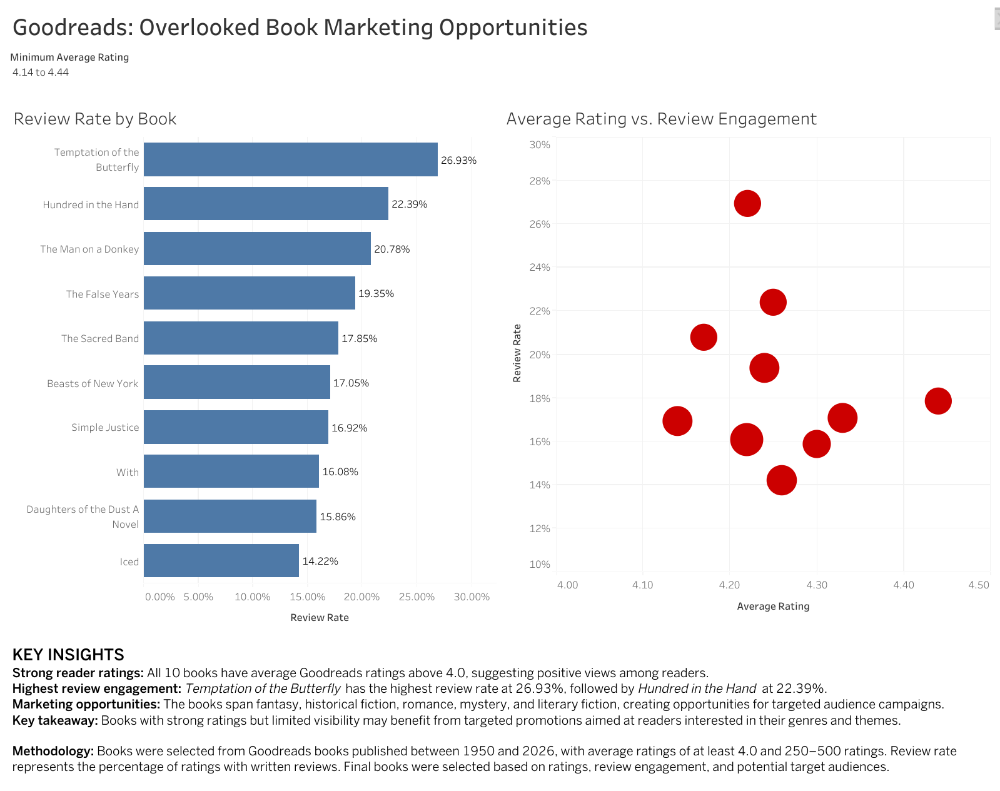

# Goodreads Marketing Analytics
### Identifying Overlooked Books with Marketing Potential

**Tools:** Python (Pandas, Jupyter Notebook) | Google BigQuery (SQL) | Excel | Tableau

[**Interactive Tableau Dashboard**](https://public.tableau.com/app/profile/justin.souza/viz/GoodreadsOverlookedBookMarketingOpportunities/GoodreadsOverlookedBookMarketingOpportunities) | [**Case Study**](Goodreads_Case_Study.pdf) | [**Presentation**](Goodreads_Presentation.pdf)

---

## Project Overview

For this project, I am a marketing analyst at a publishing house, tasked with identifying overlooked books with strong reader engagement and developing targeted marketing strategies.

Using a dataset of 500,000 book records, I analyzed ratings, reviews, genres, and publication information to find books with positive reader reception but low Goodreads engagement.

The objective was to select **10 promising fiction books**, identify their potential target audiences, and develop actionable marketing recommendations.

**Business Question:** Which highly rated, overlooked books could benefit from targeted marketing?

## Dataset & Tools

**Original Dataset:** [Goodreads Books Dataset — Hugging Face](https://huggingface.co/datasets/pfaha/goodreads-books)

**Source:** pfaha / goodreads-books

The dataset contained:
- 500,000 book records across 100 Parquet files
- 24 original columns
- Book titles, authors, publication dates, ratings, reviews, and genre information

| Tool | Purpose |
|------|---------|
| Python / Pandas | Data inspection, cleaning, and preparation |
| Jupyter Notebook | Documenting the data preparation workflow |
| Google BigQuery / SQL | Exploratory analysis, filtering, and candidate selection |
| Excel | Evaluating the final candidates and developing marketing recommendations |
| Tableau | Building an interactive dashboard to communicate findings |

## Methodology

### 1. Data Preparation & Cleaning

I used Python and Pandas to combine the 100 Parquet files into a single dataset and inspect its quality.

Key preparation steps included:
- Examining missing values and rating metrics
- Converting publication dates and extracting publication years
- Investigating incomplete genre information
- Identifying multiple editions of the same book
- Preparing separate books and genres tables for analysis in BigQuery

**Important limitation:** About 61.52% of records had no genre labels, limiting the ability of genre-based comparisons.

### 2. Exploratory SQL Analysis

I used Google BigQuery to investigate:
- Genre distributions and reader engagement
- Average ratings and written-review activity
- Minimum rating thresholds
- Highly rated books with few ratings
- Multiple editions associated with the same work
- Overlooked books across genres and publication decades

I organized the SQL queries into six files to document the progression of my analysis.

### 3. Identifying Marketing Candidates

I established the following selection criteria:

| Metric | Criteria |
|--------|----------|
| Average Rating | At least 4.0 / 5.0 |
| Ratings Count | 250–500 |
| Publication Year | 1950–2026 |
| Review Rate | (Written Reviews / Ratings Count) × 100 |

**Review rate** measures the percentage of Goodreads ratings that also have written reviews. It is not a sales conversion rate.

I also accounted for multiple editions of the same work to avoid treating them as independent works.

My initial selection included many children's books, so I changed the genre exclusions to focus more closely on adult fiction.

After reviewing 100 listed results, I selected **10 books** based on reader ratings, review engagement, genre diversity, and potential target audiences.

## Key Findings

### Strong Reader Ratings

All 10 selected books had average Goodreads ratings above 4.0, suggesting positive reception among the readers who rated them.

### Written-Review Engagement

Two books stood out for their review rates:

| Book | Average Rating | Ratings Count | Review Rate |
|------|----------------|---------------|-------------|
| *Temptation of the Butterfly* | 4.22 | 323 | 26.93% |
| *Hundred in the Hand* | 4.25 | 326 | 22.39% |

These books had the highest review percentages among the 10 candidates.

### Genre Diversity

The selected books span fantasy, historical fiction, romance, literary fiction, and mystery.

This variety creates opportunities for audience-specific marketing rather than a single broad promotional strategy.

## Marketing Recommendations

I developed recommendations tailored to each book's genre, potential readership, and engagement patterns.

| Strategy | Example Book | Recommendation |
|----------|--------------|----------------|
| Genre-Specific Promotion | *The Sacred Band* | Reach fantasy readers through Goodreads communities, BookTok, and genre-focused creators |
| Community Partnerships | *Hundred in the Hand* | Explore partnerships with historical fiction book clubs and Indigenous literature communities |
| Targeted Digital Campaigns | *Temptation of the Butterfly* | Test romance-focused social media promotions and ebook offers |

**Overall Recommendation:** Prioritize targeted, genre-specific campaigns, then measure their performance to identify the most effective approaches.

## Interactive Tableau Dashboard

I developed an interactive Tableau dashboard to help visualize and compare the final 10 marketing candidates.

The dashboard includes:
- **Review Rate by Book:** A bar chart ranking written-review engagement
- **Average Rating vs. Review Engagement:** A scatter plot comparing ratings and review rates, with bubble size representing ratings count
- **Interactive Filters:** Controls for exploring individual books and adjusting the minimum average rating
- **Book-Level Details:** Tooltips containing audience and marketing recommendations

[**View the Interactive Dashboard on Tableau Public**](https://public.tableau.com/app/profile/justin.souza/viz/GoodreadsOverlookedBookMarketingOpportunities/GoodreadsOverlookedBookMarketingOpportunities)

## Repository Contents

| File | Description |
|------|-------------|
| [01_data_validation.sql](01_data_validation.sql) | Initial data validation and quality checks |
| [02_genre_analysis.sql](02_genre_analysis.sql) | Genre distributions, ratings, and engagement comparisons |
| [03_reader_engagement.sql](03_reader_engagement.sql) | Rating thresholds and reader engagement analysis |
| [04_book_editions.sql](04_book_editions.sql) | Identifying and accounting for multiple editions of the same work |
| [05_overlooked_books_analysis.sql](05_overlooked_books_analysis.sql) | Analysis of overlooked works by genre and publication decade |
| [06_candidate_selection.sql](06_candidate_selection.sql) | Original, revised, and final candidate-selection queries |
| [Goodreads_Data_Cleaning.ipynb](Goodreads_Data_Cleaning.ipynb) | Python data preparation and cleaning |
| [Goodreads_Analysis.xlsx](Goodreads_Analysis.xlsx) | Candidate evaluation and marketing recommendations |
| [Goodreads_Case_Study.pdf](Goodreads_Case_Study.pdf) | Detailed project methodology, findings, and conclusions |
| [Goodreads_Presentation.pdf](Goodreads_Presentation.pdf) | Presentation summarizing the project |
| [Goodreads_Tableau_Dashboard.png](Goodreads_Tableau_Dashboard.png) | Screenshot of the Tableau dashboard |

## Limitations

Several limitations should be considered when looking at the findings:

- **Incomplete genre information:** Many records lacked genre labels, potentially excluding relevant books from the analysis.
- **Goodreads engagement is not sales data:** A relatively low number of ratings does not necessarily mean a book has low sales or limited market awareness.
- **Selection criteria are exploratory:** Rating thresholds and review rates help identify book options but do not show sales potential.
- **Marketing recommendations are untested:** Campaign effectiveness would need to be studied using actual performance data.

## Conclusion & Next Steps

This project shows how Python, SQL, Excel, and Tableau can work together to turn raw book data into actionable marketing recommendations.

By combining reader engagement metrics with genre and audience analysis, I found 10 fiction books that may respond well to additional marketing efforts.

If I were continuing this project for a publisher, my next steps would be to:

1. **Expand the Analysis:** Incorporate book sales, audience demographics, and additional engagement data.
2. **Test Campaigns:** Launch small, genre-specific promotional campaigns.
3. **Measure Performance:** Evaluate impressions, click-through rates, conversions, and return on investment.

---

**Author:** Justin Souza

[GitHub Profile](https://github.com/justinsouza)

